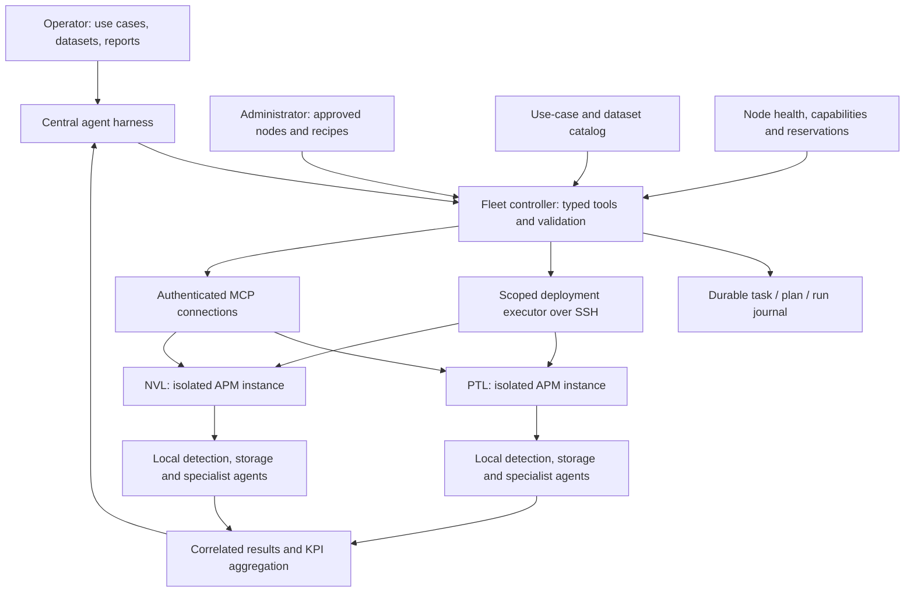
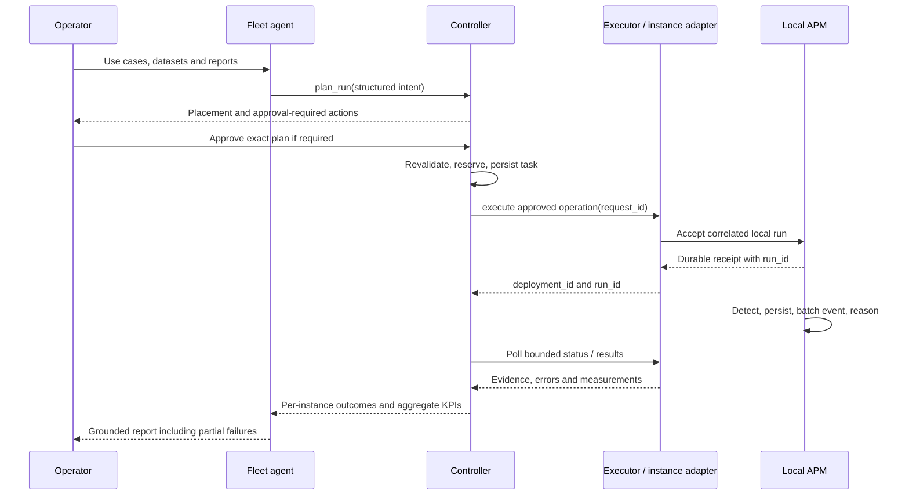

<!--
SPDX-FileCopyrightText: (C) 2026 Intel Corporation
SPDX-License-Identifier: Apache-2.0
-->

# Distributed APM instances: design proposal

**Status:** Draft for review; not implemented.
**Requirement:** [ITEP-97746](https://jira.devtools.intel.com/browse/ITEP-97746).
**Date:** 2026-11-12.
**Execution plan:** [Implementation plan](./distributed-apm-plan.md).

## 1. Summary

Add a fleet orchestration layer above existing APM application instances. An
operator describes the use cases, datasets, failures of interest and desired
reports. A central agent translates that intent into a structured request.
Deterministic services validate it, select compatible edge nodes, obtain any
required approval, deploy or reuse isolated APM instances, and run their workloads.
The controller aggregates evidence-backed results and execution metrics.

The proposed MVP distributes **complete APM instances, including their local
agent workflows**, rather than splitting the four specialist agents of one
workflow across machines. Use pipeline defect detection and gas detection as
the initial recipes, subject to model/dataset readiness. Demonstrate execution
on PTL and NVL systems running Ubuntu.

Use Factory Defects Inspector Agent (FDI) as the reference for central-agent
operation, deployment recipes, SSH execution and MCP connectivity. Add the
APM-specific catalog, placement policy, instance isolation and KPI collection.
An inventory of fixed assignments alone does not satisfy prompt-driven routing.

## 2. Requirements and interpretation

The supplied requirement export is the source for this table. Numeric KPI
targets, instance counts beyond "multiple", and the meaning of fine-grained
agent distribution are not specified in that export.

| ID | Requirement | Proposed acceptance interpretation |
|---|---|---|
| R1 | Multiple APM instances for multiple use cases on shared edge infrastructure | Two independently addressable use-case instances can run without configuration, data or lifecycle interference. Same-host coexistence is an explicit proposed engineering goal, not an assumed quotation from the requirement. |
| R2 | Test with at least two platforms; target PTL and NVL, Ubuntu | Execute real supported workloads on both physical target platforms and record hardware, OS, runtime and model versions. |
| R3 | An agent enables workload routing and agents distribution | The central agent requests validated placement; each selected node runs the workload and its per-instance reasoning agents. Decision D1 must confirm whether this is sufficient. |
| R4 | Prompts determine dataset/use case, instances and required failure/report features | Resolve requests to approved catalog entries; reject or clarify unsupported/ambiguous requests before execution. |
| R5 | Consider E2E latency, TTFT, task/orchestration throughput and human-in-the-loop KPIs | Instrument the definitions in section 12, report conditions and failures, and agree thresholds before performance acceptance. |

### Scope decisions requiring review

| ID | Proposed default | Decision still needed |
|---|---|---|
| D1 | Place the entire local Policy/Analysis/Evidence/Ticketing workflow with its APM instance. | Does "agents distribution" additionally require individual specialists of one run on separate nodes? If yes, add remote-agent task/state contracts before implementation. |
| D2 | Hermes is the initial reference harness, following FDI. | Confirm Hermes versus another required harness. "Claw related KPIs" does not by itself specify OpenClaw. |
| D3 | Two supported recipes, two physical platforms; co-location also tested within measured resource limits. | Confirm required instance count, concurrent-run count and same-host coexistence acceptance. |
| D4 | Reuse a reviewed FDI integration boundary or thin adapter; do not fork its whole installer. | Agree ownership, dependency delivery and versioning with the reference maintainers. |
| D5 | Define measurements first, establish a baseline, then agree numeric budgets. | Approve KPI thresholds, dataset sizes, concurrency and cold/warm test conditions. |

These are review gates, not claims that the requirement has already approved
the proposed defaults.

## 3. Scope and non-goals

### MVP scope

- A trusted administrator registers nodes and approved recipes.
- A prompt selects one or both supported use cases, compatible datasets and
  supported output sections.
- Placement considers verified capabilities, instance slots, resource budgets,
  dataset/model availability and current health.
- The controller can enable a new instance or reuse an idle compatible instance.
- Each instance exposes scoped run/status/result operations through an MCP adapter.
- Concurrent independent instances retain separate data, credentials and outputs.
- The controller records partial failures and correlated KPIs.

### Non-goals

- Kubernetes, a general-purpose cluster scheduler, HA control-plane replication,
  live migration or unrestricted autoscaling.
- Arbitrary code, shell commands, URLs, models or datasets supplied through chat.
- Training new models or inventing a detector for an unsupported failure type.
- Automatic equipment control or an engineering safety/compliance determination.
- Fine-grained cross-node specialist execution unless D1 explicitly requires it.
- A centralized shared detection database for all instances.
- Automatically restarting ambiguous in-flight work after a network failure.

## 4. Current implementation and reuse boundary

APM already separates detection, storage, agent reasoning and UI services. Its
detection service starts a bounded video or multimodal run, persists detections,
and publishes a batch-complete event. Agent Quality Handler reads the corresponding
storage window and produces local reasoning results.

| Existing component | Reuse | Required change |
|---|---|---|
| `setup.sh` and `docker/compose.*.yaml` | Per-use-case deployment and hardware configuration | Instance-scoped projects, ports, paths, lifecycle and cleanup |
| Detection service | `/detection/run`, `/detection/run-multimodal`, run status | Durable request acceptance/correlation for safely retried fleet calls |
| Storage service | Per-instance detection store and queries | Preserve isolation; do not reinterpret IDs as globally unique |
| Agent Quality Handler | Local specialist workflow and results | Keep external-service compatibility; add correlation/telemetry integration where supported |
| UI and Nginx | Existing local dashboard and routes | Keep local views; fleet chat/reporting is a separate control-plane view |
| Metrics Manager / Prometheus | Existing host/service observations | Validate capability schema, freshness and resource-budget use; add task/model measurements |

Current restrictions relevant to R1:

- Compose files set fixed `container_name` values and several published ports.
- `setup.sh` stops fixed names and removes volumes selected by name suffix.
- The detection lock and run registry are process-local.
- Detection membership uses a storage-ID window, not a fleet-wide identity.
- Detection Compose enables startup clearing of its configured store.
- The inspected APM services do not expose the fleet MCP contract proposed below.

FDI provides recipe validation, per-deployment checkouts/profiles, remote
deployment, SSH tunnels, credential references and MCP tool allow-lists.
Its node/recipe assignments are supplied by an administrator; they are not
computed from APM intent or resource capacity. Its Hermes node profiles are
central contexts with SSH terminals, not proof of remotely placed model inference.

## 5. Architecture

The diagram is a proposed topology, not a claim of deployment. The central
controller can share one target platform if its reserved resources permit;
a third physical host is not mandatory.

### Responsibilities

| Component | Owns | Must not do |
|---|---|---|
| Agent harness | Intent interpretation, clarification, explanation and tool invocation | Bypass validation/approval or generate unrestricted deployment commands |
| Fleet controller | Catalog resolution, placement, admission, task state, result aggregation | Treat LLM output, inventory or stale telemetry as proof of readiness |
| Deployment executor | Approved recipe operations on one explicit deployment | Change unrelated containers, host configuration or another instance |
| Instance MCP adapter | Typed access to one instance's capabilities, runs and results | Accept arbitrary paths, shell text or a different instance's credentials |
| Local APM services | Detection, local storage and domain reasoning | Depend on fleet availability to preserve completed local evidence |

Use one central controller process with a local durable SQLite journal for the
sample. Keep its state private and backed up according to deployment policy.
This is not an HA design. Do not put a SQLite file on a cross-host shared mount.

## 6. Catalog and identities

### Approved catalog

Each versioned recipe declares:

- `use_case_id`, recipe version, supported failure labels and input modalities;
- reviewed application/image revisions, model revision/checksums and preprocessing;
- supported, validated device/runtime combinations and measured resource budget;
- dataset IDs, versions/checksums, availability and required attribution;
- expected dataset shape, sensor pairing and video/manifest preparation if applicable;
- supported report sections, local API kind and readiness/inference checks;
- approved deployment actions and lifecycle/cleanup boundaries.

The first candidate entries are `pipeline-defect-detection` and `gas-detection`.
The latter's directory is `apps/gas-detection-multimodal`; catalog IDs must not
be inferred from directory names. Dataset identifiers must be chosen and
populated during implementation; examples must not masquerade as published data.

Requested reports select supported outputs for presentation. They do not
silently remove required policy/evidence steps from the local sequential workflow.
Unsupported failure types or reports, such as remaining-useful-life prediction
without an appropriate model, produce an explicit unsupported response.

### Identity model

| Identity | Meaning |
|---|---|
| `node_id` | Stable identity of a registered physical platform |
| `deployment_id` | Unique APM instance identity, independent of its use case |
| `task_id` | One operator request, potentially containing several workload runs |
| `plan_id` / `plan_version` | Immutable proposed placement and action set |
| `request_id` | Idempotency key for one mutating tool/API operation |
| `run_id` | Local APM run ID, scoped by `deployment_id` |
| `trace_id` | Correlates controller, tool, workload and model observations |

Results are addressed by `(deployment_id, run_id)` and retain `node_id`,
recipe/model/dataset versions and time range. Never merge bare frame IDs or
detection IDs from different stores.

### Node registry

Record approved SSH identity/host-key policy, OS/platform, validated devices,
available instance slots, configured budgets, observed health/freshness, and
installed model/dataset versions. Secrets are referenced, not embedded.
Registered CPU/GPU/NPU presence is not proof that a particular exported model
works on that device.

## 7. Request planning and placement

1. Parse the prompt into a typed intent: supported use cases, failure features,
   dataset IDs, requested reports, optional node/device preferences and instance count.
2. Resolve the intent against the catalog. Clarify multiple matches; reject
   unsupported features without side effects.
3. Obtain fresh node and instance observations. Reject unknown or stale eligibility.
4. Filter by policy, model/device validation, resource budget and data availability.
5. Prefer a compatible idle instance, then local prepared data/models, then lower
   reserved load. Use stable node-ID ordering for deterministic ties. An explicit
   approved user placement preference takes precedence if still eligible.
6. Produce an immutable plan including targets, versions, inputs, reports,
   resource reservations, necessary preparation/deployment and expected side effects.
7. Obtain policy-required approval. Bind it to the exact plan version and action set.
8. Revalidate and atomically reserve capacity before dispatch. If eligibility or
   the approved action set changes, replan and obtain fresh approval as required.

Use configured per-recipe budgets and bounded instance/run slots rather than
attempting to infer reliable memory admission from one utilization sample.
Two simultaneous plans must not reserve the same last slot. Stale plans expire;
running or uncertain workloads retain reservations until reconciliation confirms
their terminal state.

Workload routing must be observable: the report names the selected node/instance
and the placement reason. A static administrator assignment remains an allowed
constraint, not the complete routing algorithm.

## 8. Deployment and instance isolation

Use a unique Compose project per `deployment_id`. Remove explicit global container
names or derive unique names; service aliases can remain local to each project.
Allocate loopback-bound host ports where host access is required. Isolate mounts,
database volumes, agent outputs, credentials and mutable runtime configuration.

Change stop/clean operations to target the exact project and its recorded
resources. Do not use global names or suffix searches. Preserve the legacy
single-instance UX with a documented default instance; it must not match every
fleet deployment.

Keep a broker and store per instance for the MVP. Identical topic names are safe
only when brokers are isolated. If a shared broker is introduced later, namespace
raw/batch topics and client IDs throughout the producer/consumer chain.

Existing per-instance detection-ID windows and the local single-run lock can
remain for the first release. Startup clearing must never reach another instance's
store. Define and test the history-retention behavior for the default instance
before changing it. Do not pool detectors into one database as a shortcut.

Provision read-only model/dataset artifacts separately from mutable workspaces.
Only verified artifacts may be reused across instances. Preserve licenses and
dataset attribution. A deployment must not replace a running instance in-place:
stage a new revision, verify readiness and inference, then explicitly transition
ownership. Never automatically migrate an in-flight run.

### FDI integration

Reuse the recipe/executor/harness boundary after D4 is resolved. Add APM recipes
and a deployment skill that invokes reviewed commands with typed parameters.
Adapt the reference's one MCP endpoint/profile per deployment. Allocate distinct
remote and central tunnel ports for co-located instances; isolated checkouts alone
do not isolate container names or ports.

Prefer connect-only operation for administrator-prepared applications. Keep
node/bootstrap preparation separate from normal operator execution. Pin reviewed
dependency revisions; do not pull a moving branch on every operator request.

The initial model-serving choice is explicit per recipe: the controller's model
and local APM reasoning models have separately budgeted capacity. Shared serving
is an optional optimization requiring contention and endpoint compatibility checks.
FDI's Inference Router `/v1` and APM's existing OVMS `/v3` configuration must not
be treated as interchangeable without verification.

## 9. Proposed tool contracts

These are **new proposed tools**, not existing executable commands. Use validated
request/response schemas, bounded result sizes and explicit target identifiers.

| Tool | Main input | Result / behavior |
|---|---|---|
| `list_use_cases`, `list_datasets` | Optional supported filters | Versioned catalog entries and compatibility |
| `list_nodes`, `list_instances` | Optional node/deployment ID | Eligibility, health, freshness and capacity |
| `plan_run` | Structured intent | Immutable plan, placement reasons and required approvals |
| `execute_plan` | Plan ID/version, request ID, authorization context | Durable task receipt; deploy/reuse and launch only approved actions |
| `get_task_status` | Task ID | Per-instance preparation, detection and reasoning states |
| `get_run_results` | Deployment ID and run ID | Bounded outputs with evidence/version references |
| `get_kpis` | Task/run filter | Measurements, observation conditions and unavailable fields |
| `stop_instance` | Deployment ID, expected revision, request ID, authorization context | Scoped administrative operation; reject active-run conflicts unless an explicit supported cancellation policy applies |

The central executor owns privileged deployment; an instance MCP adapter owns
local application calls. Map video and multimodal requests to the existing
endpoints through catalog IDs, not operator-provided `config_path` strings.
Do not put approval tokens, credentials or arbitrary URLs into model prompts.

Read tools can retry within bounded deadlines. Mutation retries must use the
same persisted `request_id` and payload hash. The receiving side must return the
original receipt for an identical accepted operation and reject key reuse with
different parameters.

## 10. Execution, persistence and failure behavior

Proposed task states: `PLANNED`, `AWAITING_APPROVAL`, `QUEUED`, `PREPARING`,
`RUNNING`, `COMPLETED`, `PARTIAL_FAILED`, `FAILED`, `CANCELLED`, `UNKNOWN`.
Keep preparation, detection and reasoning sub-states per workload. A task is
completed only when all requested workloads and required reports are complete;
successful detection alone is insufficient.

Persist task/plan identities, approvals, reservations, operation receipts,
local run mappings and result references. Add durable idempotent acceptance at
the side-effect owner, including the local detection-start boundary; a controller
cache alone cannot prevent a duplicate when a successful HTTP response is lost.
Keep any new request fields backward-compatible for existing clients.

After a timeout or controller restart, reconcile the saved receipt with the target.
If the target cannot establish whether an operation was accepted, mark it
`UNKNOWN`, preserve its reservation and require bounded recovery/manual review.
Do not issue a new run simply because the original response was lost.

The existing MQTT handoff is not an exactly-once queue. Detect missing reasoning
completion through local status/evidence and surface the failure. Retry or
re-trigger reasoning only when the target supports an idempotent, bounded run
contract; otherwise require explicit recovery. A timed-out request does not
authorize destruction of its containers or data.

Failure of one node must not erase another node's successful results. Record
partial completion and the affected targets. Treat cancellation as a separate
approved operation; do not claim cancellation until the executing component
confirms it.

## 11. Security and operational boundaries

- Treat prompts, model output, datasets, tool results and remote logs as untrusted.
- Validate schemas, lengths, enumerations and ownership at tool/API boundaries.
- Enforce authorization server-side; persona text and profile selection are not access control.
- Separate deployment/stop/cleanup authority from status/results access.
- Use approved SSH hosts and host-key verification, authenticated MCP connections,
  tunnel/transport protection and the reference's certificate-verification approach.
- Keep credentials in approved environment-based provisioning paths, out of
  catalogs, prompts, command arguments and reports.
- Use a dedicated deployment identity; acknowledge that Docker management is
  privileged. Do not expose a Docker socket or unrestricted shell tool to operator chat.
- Use only approved model providers for operational data; a configured local
  provider must not silently fall back to an external service.
- Keep endpoint exposure minimal. Do not copy privileged telemetry configuration
  into every instance without a reviewed necessity; reuse host observations where suitable.
- Log target identity, action, authorization outcome and result without secrets.
- Obtain explicit consent for destructive or operationally impactful changes.
  HITL measurement must not incentivize bypassing required approvals.

Review these new boundaries before implementing the tools or deployment changes.

## 12. Observability and KPI definitions

| Measurement | Definition |
|---|---|
| Task E2E latency | Central prompt acceptance to all required reports becoming available; failures/partial tasks reported separately |
| Workload E2E latency | Accepted workload dispatch to that workload's completed report |
| TTFT | Model-request submission to its first streamed token; distinguish controller and local-agent calls |
| User-visible first response | Prompt acceptance to first displayed response; not interchangeable with model TTFT |
| Orchestration latency | Intent/catalog resolution, planning, queueing, approval wait and dispatch durations reported separately |
| Task throughput | Successfully completed operator tasks per observation interval at stated concurrency |
| Workload throughput | Successfully completed workload runs per interval; do not confuse with task count or detector FPS |
| HITL | Approval, clarification and recovery interventions, plus time waiting for humans, per task |
| Reliability | Accepted/completed/failed/partial/unknown/cancelled counts, retries and timeout rates |

Report cold preparation/model download/load separately from warm execution.
Include hardware/device, recipe/model/dataset revisions, data volume, concurrency
and model-serving configuration. Report sample counts and latency distributions,
including p50/p95 when the run count supports meaningful interpretation.

Use a central clock for user-visible E2E boundaries and monotonic local durations
inside each process. Record UTC timestamps for correlation and document clock
synchronization/skew; do not subtract unrelated node clocks for latency.
Keep high-cardinality task/run IDs in traces or the journal rather than unbounded
Prometheus labels.

True TTFT requires streaming observations or model-serving instrumentation.
Mark unavailable TTFT explicitly; do not estimate it from total completion time.
In fallback mode, model TTFT is not applicable, not zero. Extend existing telemetry
only where necessary; choose instrumentation dependencies during implementation.

## 13. Verification and rollout

See the [implementation plan](./distributed-apm-plan.md) for dependencies,
deliverables and the verification matrix.

Preserve the single-instance flow. Introduce fleet mode as an opt-in path and
retain direct local APIs. Start with mocked tools for controller behavior, then
one real instance, same-host coexistence if approved, and finally PTL/NVL operation.
Require independent health, inference, storage, reasoning and report evidence.

Hardware unavailability, unsupported model/device combinations, missing datasets,
or absent true-TTFT instrumentation are explicit blockers or measurement gaps.
They must not be reported as passing requirements.

Rollback a fleet deployment only by its recorded instance/revision and after
handling active work. Retain previous artifacts and outputs; do not run broad
Docker cleanup. This draft does not authorize deployment or changes to existing stacks.

## 14. Source references

- [Current APM setup](../../setup.sh), [base Compose](../../docker/compose.base.yaml),
  [detection Compose](../../docker/compose.detection.yaml),
  [agent Compose](../../docker/compose.agents.yaml).
- [Detection orchestration](../../services/detection-service/src/main.py),
  [MQTT publisher](../../services/detection-service/src/mqtt_publisher.py),
  [storage identity windows](../../services/storage-service/src/sqlite_client.py).
- [Existing telemetry](../../docker/compose.telemetry.yaml),
  [current execution flow](../user-guide/how-it-works.md).
- FDI reference inspected at revision
  `91183f31926ad08eff7723a2fcb8137beb76bee6`:
  [get started](https://github.com/open-edge-platform/manufacturing-ai-suite/blob/91183f31926ad08eff7723a2fcb8137beb76bee6/factory-defects-inspector-agent/docs/user-guide/get-started.md),
  [inventory](https://github.com/open-edge-platform/manufacturing-ai-suite/blob/91183f31926ad08eff7723a2fcb8137beb76bee6/factory-defects-inspector-agent/hosts.yaml),
  [planner](https://github.com/open-edge-platform/manufacturing-ai-suite/blob/91183f31926ad08eff7723a2fcb8137beb76bee6/factory-defects-inspector-agent/fleet_inventory.py),
  [harness adapter](https://github.com/open-edge-platform/manufacturing-ai-suite/blob/91183f31926ad08eff7723a2fcb8137beb76bee6/factory-defects-inspector-agent/agents/hermes.sh).
