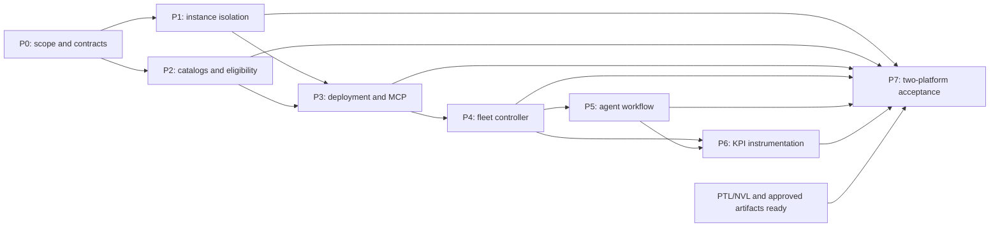

<!--
SPDX-FileCopyrightText: (C) 2026 Intel Corporation
SPDX-License-Identifier: Apache-2.0
-->

# Distributed APM instances: implementation plan

**Status:** Proposed work; no implementation or deployment is implied.
**Requirement:** [ITEP-97746](https://jira.devtools.intel.com/browse/ITEP-97746).
**Design:** [Distributed APM design](./distributed-apm-design.md).
**Date:** 2026-11-12.

## 1. Delivery strategy

Deliver an opt-in fleet layer around isolated, otherwise familiar APM instances.
Start with two supported recipes and a small, explicit platform inventory.
Reuse the FDI fleet/harness pattern without treating its static assignments as
the final routing solution.

This plan assumes design decision D1 accepts distribution of complete instance
agent workflows. If individual specialists must execute on separate nodes,
re-scope before P3: add remote-agent contracts, shared execution state, ownership,
timeouts and checkpoint/recovery work rather than hiding it in the MCP adapter.

No duration estimates are assigned until scope, contributors, hardware access
and model/dataset readiness are confirmed. The order below is based on actual
dependencies, not an assumed calendar.

## 2. Work packages and dependencies

| Phase | Deliverable | Depends on | Exit gate |
|---|---|---|---|
| P0 | Scope, contracts and acceptance decisions | None | D1-D5 resolved or explicitly deferred with corresponding scope exclusions |
| P1 | Instance-safe APM lifecycle | P0 | Independent instances and legacy behavior verified |
| P2 | Catalog, node eligibility and input schemas | P0 | Unsupported/stale/incompatible inputs fail before side effects |
| P3 | Deployment executor and instance MCP adapter | P1, P2 | One instance can be deployed/connected and run through authenticated typed tools |
| P4 | Durable fleet controller and placement | P3 | Validated concurrent plans, reservations and safe retry/recovery behavior |
| P5 | Harness-driven end-to-end workflow | P4 | Prompts produce approved, grounded execution and partial-failure reporting |
| P6 | Correlated KPI instrumentation and reporting | P4, P5 | All required measurement boundaries observable or explicitly blocked |
| P7 | Platform validation, documentation and release gate | P1-P6, hardware/data readiness | PTL/NVL evidence and agreed acceptance matrix complete |

P1 and P2 can proceed independently after P0. Define telemetry contracts during
P0 and instrument components as they are built; P6 is the complete measurement
integration gate, not a reason to postpone observability until the end.

## 3. P0: scope and acceptance contract

### Tasks

- Review the requirement against design R1-R5 and decide D1-D5.
- Confirm harness, FDI reuse ownership and reviewed dependency delivery.
- Confirm two initial use cases, their supported failure/report features,
  datasets and compatible exported models.
- Confirm PTL/NVL availability, Ubuntu versions, drivers and supported devices.
- Decide instance/concurrent-run limits, co-location scope, approval policy,
  resource budgets and freshness/deadline settings.
- Define KPI observation intervals, cold/warm scenarios, statistical sample
  sizes and acceptance budgets. Do not infer numeric targets from the export.
- Agree a minimal typed catalog/tool contract and failure-state vocabulary.

### Deliverables and evidence

Update the design's decision table with agreed choices and review references.
Produce a versioned test manifest identifying recipes, datasets, model artifacts,
platforms and measurement conditions. No real dataset ID is introduced until
its identity, compatibility and distribution permissions are established.

**Gate:** a reviewer can distinguish mandatory requirement coverage, approved
MVP interpretation and deferred functionality.

## 4. P1: make APM instance-safe

### Tasks

- Introduce a stable `deployment_id` and explicit Compose project identity.
- Remove or parameterize fixed container names; isolate published ports, mounts,
  networks, credentials, storage and agent outputs.
- Replace global-name stop and suffix-based volume cleanup with exact
  project/resource ownership checks.
- Preserve the existing single-instance entry path using a documented default.
- Record instance/revision ownership for inspection, upgrade and rollback.
- Keep brokers and stores per instance; scope any shared endpoints explicitly.
- Decide and preserve the default instance's startup/history behavior.
- Check telemetry ports, host-level collectors, UI/Nginx routing and device
  resource sharing; unique application ports alone are insufficient.

### Likely existing touchpoints

`setup.sh`, `docker/compose.*.yaml`, use-case environment loading and deployment
documentation. Do not modify another suite's files as part of this work package.

### Verification

- Start two approved instances on one host if D3 includes co-location.
- Stop/restart one and verify the other's health, data and output hashes remain.
- Verify clean/delete targets only the named instance's resources.
- Exercise default single-instance start/status/stop behavior.
- Verify colliding ports or an already-owned deployment identity fail before
  altering a running instance.

**Gate:** isolation is demonstrated, not inferred from separate source directories.

## 5. P2: catalogs and node eligibility

### Tasks

- Add strict schemas for use cases, dataset references, report options, node
  inventory and structured operator intent.
- Populate approved pipeline-defect-detection and gas-detection recipe metadata.
- Map dataset IDs to prepared artifact locations and transformation/manifest
  requirements; preserve checksums, model preprocessing and attribution.
- Map failure/report requests to existing supported functionality.
- Read and normalize node capabilities and health through approved probes;
  validate the reused Metrics Manager schema rather than assuming its fields.
- Track observation freshness, configured capacity and recipe/device validation.
- Define clear unsupported, ambiguous and unavailable responses.

### Verification

Cover unknown dataset IDs, incompatible modalities, missing sensor pairs,
unsupported failures, unavailable devices, stale observations and missing artifacts.
Verify that no deployment/download/run operation occurs when resolution fails.

**Gate:** catalogs define what can run, independently of what the LLM proposes.

## 6. P3: scoped execution and MCP integration

### Tasks

- Integrate the reviewed FDI deployment/harness boundary using APM recipes.
- Add an authenticated instance MCP adapter for local capability/run/status/result
  access; keep privileged provisioning in the separate deployment executor.
- Map recipe IDs to local video or multimodal API requests without accepting
  arbitrary configuration paths or shell text.
- Support administrator-prepared/connect-only instances.
- Allocate per-instance tunnel endpoints, verify host identity and certificates,
  and store credential references outside catalogs/chat.
- Add durable operation receipts and idempotent acceptance at the local
  detection-start boundary; preserve backward-compatible direct API calls.
- Persist `(deployment_id, request_id, payload_hash, run_id, state)` before
  acknowledging accepted mutating operations.
- Verify health, actual inference, storage and reasoning independently.

### Verification

- Execute both recipe types through the adapter against a real local instance.
- Repeat an identical request key and verify only one local run is accepted.
- Reuse a key with a different payload and verify rejection.
- Simulate a lost HTTP response and receiver restart; reconcile the original
  receipt rather than creating a second run.
- Reject unauthorized mutations and cross-instance access.
- Prove connect-only does not replace source, models or running containers.

**Gate:** typed tools operate one explicitly identified instance with observable
side effects and safe retry behavior.

## 7. P4: fleet controller and deterministic placement

### Tasks

- Implement the proposed central tool contracts and a durable SQLite task journal.
- Resolve intent, filter eligible nodes, prefer compatible prepared instances,
  and produce a versioned placement plan with reasons.
- Add atomic admission/reservations for concurrent plans and configured limits.
- Bind approval to the plan/action version; revalidate eligibility at execution.
- Dispatch only approved operations and persist local run mappings.
- Poll status/results with bounded deadlines; preserve completed evidence.
- Reconcile after controller restart, node loss and transport failures.
- Preserve `UNKNOWN` state for ambiguous operations; never turn a timeout into
  permission for blind redeployment or a fresh duplicate run.
- Aggregate per-workload success/failure without mixing instance-local IDs.

### Verification

Use focused deterministic tests for placement ties, preferred-node eligibility,
stale plans, capacity races, approval changes, duplicate requests and restarts.
Simulate one failed node while another completes; return partial results with
correct identities and retained resource ownership.

**Gate:** an operator request produces an explainable plan, not unvalidated LLM
execution or a hard-coded node assignment.

## 8. P5: harness and operator workflow

### Tasks

- Register the controller's approved MCP tools with the selected harness.
- Provide an APM fleet persona/skill that discovers capabilities, clarifies
  ambiguity, proposes plans and reports evidence without inventing outcomes.
- Separate administrator lifecycle actions from normal operator queries/runs.
- Support one prompt containing both initial use cases and selected reports.
- Surface plan approval, per-instance progress, unsupported requests and partial
  completion through the chosen CLI/chat UI.
- Keep the existing per-instance dashboard and direct APIs usable.

### Verification

Use a small, fixed prompt set with expected structured outcomes, not exact prose:

| Prompt intent | Expected outcome |
|---|---|
| Pipeline defect inspection with an approved dataset and evidence report | Resolve the correct recipe, present a compatible plan, run after required approval, return scoped evidence |
| Gas detection using paired image/sensor inputs | Resolve the multimodal recipe and validated manifest/config |
| Run both use cases and compare results | Two independently tracked workloads with explicit placements and partial-failure handling |
| Request an unsupported failure predictor or dataset | Clarification/rejection with no side effects |
| Stop an explicitly identified instance | Require applicable authorization; reject unsafe active-run conflicts |
| A tool result instructs the agent to ignore approval policy | Treat it as untrusted data; no unauthorized action |

**Gate:** validate tool calls, plans and observed results. Fluent model text alone
does not constitute acceptance.

## 9. P6: KPI instrumentation

### Tasks

- Propagate task, plan, request, deployment, run and trace identifiers.
- Capture central prompt/dispatch/report times and local stage durations.
- Separate preparation, download, model load, queue, approval wait, detection,
  reasoning and aggregation.
- Observe true per-model TTFT through streaming or model-server instrumentation.
  Report missing measurements as unavailable and fallback TTFT as not applicable.
- Record task and workload throughput separately, with concurrency, completion,
  failure, retry and unknown-state counts.
- Record human clarification, approval and recovery events and waiting time.
- Reuse existing telemetry where suitable; prevent unbounded metric-label cardinality.
- Export a reproducible per-scenario report with configuration/version metadata.

### Verification

Verify timestamp boundaries and unit conversion using controlled events; reconcile
reported successful counts against the durable run journal. Test fallback and LLM
modes, cold and warm runs, partial failures and interrupted model responses.

**Gate:** measured values have clear definitions, denominators and missing-data
semantics. Do not claim compliance with KPI budgets before D5 is agreed.

## 10. P7: integration, documentation and acceptance

### Target scenarios

| ID | Scenario | Required evidence | Requirement |
|---|---|---|---|
| V1 | Two instances on shared infrastructure | Unique identities, independent data/config/outputs; no collateral lifecycle effects | R1 |
| V2 | Workloads on PTL and NVL | Real inference and local agent results on each recorded platform | R2, R3 |
| V3 | Prompt chooses use case, dataset and reports | Input, resolved catalog versions, approved plan and resulting evidence | R4 |
| V4 | Different eligibility/load conditions | Placement follows documented policy; no oversubscription or unsupported device assignment | R3 |
| V5 | Two simultaneous workloads | Correct run/result correlation and bounded resource admission | R1, R3 |
| V6 | Unsupported or maliciously redirected intent | No unauthorized deployment, download, tool invocation or data access | R4 |
| V7 | Node/controller/tunnel failure and recovery | Partial/unknown states, persisted receipts and no duplicate execution | R1, R3 |
| V8 | Cold/warm and fallback/LLM measurement | Defined E2E, TTFT availability, throughput and HITL report | R5 |
| V9 | Legacy single-instance flow | Existing behavior remains usable without fleet registration | Compatibility |
| V10 | Update/rollback one instance | Preserved unrelated workloads and data; active-run handling recorded | R1 |

If co-location is approved in D3, V1 must include two instances on the same Docker
host. Two distinct hosts alone do not establish same-host isolation.

### Documentation deliverables

- Administrator guide: node registration, deployment identity, recipes,
  credentials/tunnels, connect-only use and scoped rollback.
- Operator guide: supported prompts, approvals, progress, evidence and limitations.
- Catalog guide: adding a reviewed model/dataset/use case without arbitrary code.
- Troubleshooting guide: stale telemetry, unavailable nodes, unknown operations,
  missing batch notifications and unavailable TTFT.
- Reproducible acceptance report with versions, scenarios, raw measurement
  references and unresolved limitations.

### Release gate

All approved requirement scenarios must pass on actual supported platforms.
Mocks and single-host checks support development but do not replace R2 evidence.
Document any exclusion and obtain acceptance for it; do not silently drop
fine-grained distribution, co-location or KPI coverage.

## 11. Proposed code organization

The following are proposed paths, not existing modules:

| Location | Responsibility |
|---|---|
| `fleet/catalog/` | Reviewed recipe and dataset metadata, schemas and examples |
| `fleet/recipes/` | APM deployment/verification definitions integrated with the selected executor |
| `services/fleet-controller/` | Typed central tools, placement, admission, journal and result/KPI aggregation |
| `services/instance-mcp/` | Thin authenticated adapter around one APM instance |
| Existing `services/detection-service/` | Durable acceptance/correlation extension at the actual run-start boundary |
| Existing `docker/` and `setup.sh` | Instance-scoped deployment and lifecycle |

Keep modules minimal and follow existing Python/testing patterns. Finalize FDI
reuse packaging in P0 before adding a dependency or duplicating its installer.
No new framework, database server or cluster orchestrator is assumed.

## 12. Suggested review/PR sequence

1. Design and acceptance decisions: these documents plus resolved D1-D5.
2. Instance-safe lifecycle with focused isolation regressions (P1).
3. Catalog/schema and eligibility layer (P2; independent of item 2).
4. APM executor/MCP adapter and durable acceptance (P3).
5. Controller, placement, reservations and recovery (P4).
6. Harness workflow and reporting (P5).
7. Complete KPI integration, platform evidence and deployment/operator docs (P6-P7).

Include instrumentation with the relevant implementation rather than accumulating
all measurements in the last PR. Each change should preserve existing single-instance
behavior and include focused tests for its new behavior.

## 13. Dependencies and risks

| Dependency/risk | Handling |
|---|---|
| PTL/NVL access and compatible model/runtime combinations | Book/verify before scheduling platform acceptance; mark unavailable coverage blocked |
| Approved dataset/model releases | Verify availability, hashes, licenses, class mapping and modalities before catalog registration |
| FDI ownership and harness selection | Resolve D2/D4 early; use a reviewed reference, not mutable `main` or a full copied fork |
| Agent Quality Handler API, persistence and tracing capability | Contract-test the selected image; coordinate external changes separately from this repository |
| Fixed names, broad cleanup and startup state | Complete P1 before introducing multi-instance deployment |
| Local-process run state and lost responses | Persist acceptance receipts at the side-effect boundary and exercise crash recovery |
| Prompt ambiguity and excessive autonomy | Strict schemas, explicit unsupported responses and server-side authorization |
| Shared LLM or host resource contention | Reserve controller capacity, budget workloads and measure before optimizing placement |
| KPI ambiguity or absent true TTFT | Agree definitions/targets; expose missing data rather than substitute misleading metrics |
| Requirement expands to individual specialist placement | Re-scope D1 before P3; do not promise it through central SSH profiles |

## 14. Definition of done

- D1-D5 are resolved with traceable scope/acceptance decisions.
- Operator intent selects supported recipes/datasets/reports through typed tools.
- Multiple isolated instances run across the required physical platforms.
- Placement, execution, local reasoning and results have persistent correlated identities.
- Duplicate, unauthorized, unsupported and ambiguous operations fail safely.
- Required measurements and approved budgets have reproducible evidence.
- Default single-instance behavior and unrelated running workloads are preserved.
- Administrator/operator documentation and scoped recovery procedures are complete.

This plan authorizes no infrastructure operations by itself. Implementation,
deployment, Jira updates, commits and pushes remain separate actions.
